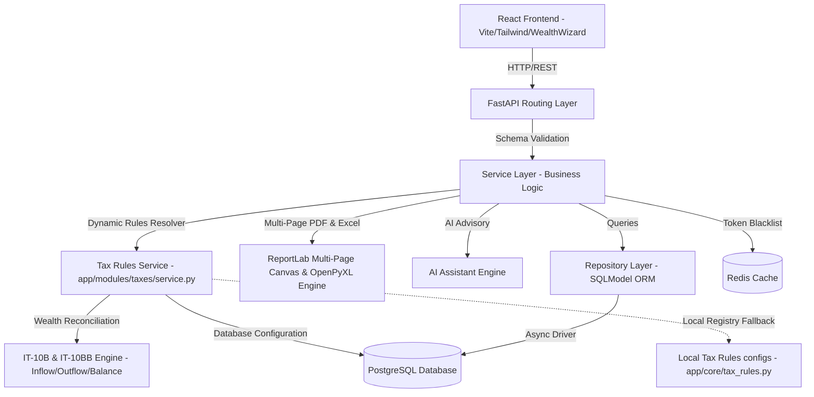

# System Architecture

The Bangladesh Tax Suite follows a **Clean Architecture + Modular Monolith** structure designed for scalable SaaS applications.

## Architecture Diagram



## Layers of the Monolith

1. **API Router Layer (`app/modules/*/api.py`)**
   - Handles REST HTTP routing, request validation via Pydantic v2, and access control dependencies (`get_current_user`, `get_current_active_admin`).

2. **Service Layer (`app/modules/*/service.py`)**
   - Contains business logic:
     - Tax slab calculations & statutory 1/3rd salary exemptions ($\min(\text{Gross}/3, 450,000)$).
     - Section 78 investment rebate limits & assessment-year caps.
     - IT-10B double-entry wealth reconciliation ($\text{Inflow} == \text{Outflow}$, $\text{Difference} = 0$).
     - Multi-page ReportLab official Form IT-11GA (2023) PDF rendering.
     - PyPDF OCR document parsing & AI Tax advisory assistants.

3. **Repository Layer (`app/modules/*/repository.py`)**
   - Encapsulates database CRUD operations using SQLModel and SQLAlchemy AsyncSession.

4. **Model & Schema Layer (`model.py`, `models_it10b.py`, `schema.py`)**
   - `model.py` and `models_it10b.py` define SQLModel database table entities.
   - `schema.py` defines type-safe Pydantic request/response validation schemas.

---

## Domain Modules Structure

```text
backend/app/modules/
├── auth/          # JWT Login, Multi-Role Register, Refresh Token, Logout
├── users/         # Super Admin Oversight, User status approval/suspension
├── employers/     # Corporate employer registrations and company directories
├── employees/     # Employee job profiles, tax zone/circle, NID info
├── salaries/      # Monthly salary slips, PDF payslips, annual summary
├── investments/   # DPS, Sanchayapatra, Insurance, AIT Challan tracking
├── taxes/         # Income Tax Act 2023 engine, IT-10B Wealth & IT-10BB Expense models
├── reports/       # ReportLab Multi-Page NBR Form IT-11GA PDF & OpenPyXL Excel Exporters
├── ocr/           # PyPDF OCR text parser for uploaded salary PDFs
└── ai/            # AI Tax Advisory Assistant based on Act 2023 regulations
```

